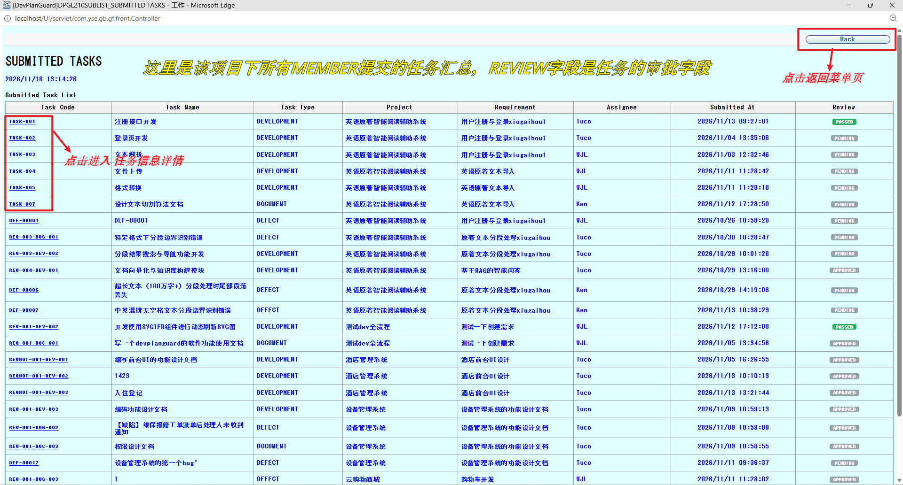
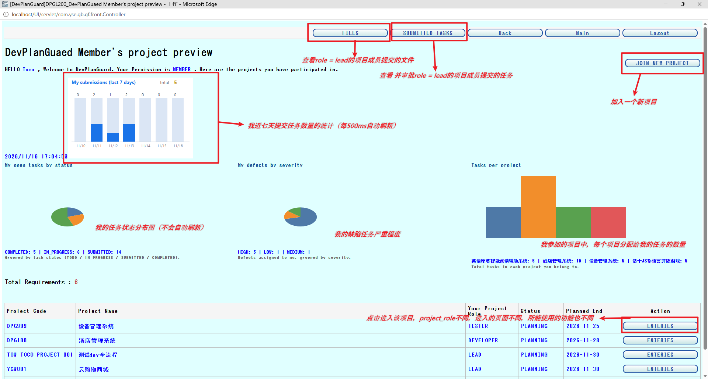

# DevPlanGuard — Keep Development on Track.

**A Project Progress and Quality Management System for Software Development Teams**

DevPlanGuard is a project management system designed for small software development teams. It provides a structured workflow for managing project requirements, development tasks, testing, bug fixes, and project progress.

The system focuses on task workflow automation, deadline tracking, and role-based access control to improve development transparency and project management efficiency.

## PROJECT_SHOW(To be completed)

## 

---

## 

---

## 

---

## 

---

## 

---

## 

---

## Key Features

### 1. Project Management

- Create and manage software development projects.
- Manage project members and their responsibilities.
- Assign project leaders and project managers.
- Track overall project progress.

### 2. Requirement Management

- Create and maintain project requirements.
- Associate requirements with development tasks.
- Track requirement implementation progress.
- Manage requirement status and changes.

### 3. Task Management

- Support multiple task types:
  - Development
  - Testing
  - Bug Fixing
  - Regression Testing
  - Documentation

- Assign tasks to team members.
- Track task status and completion.
- Maintain parent-child relationships between related tasks.

### 4. Automated Task Workflow

Automatically generate follow-up tasks based on task types and execution results, reducing repetitive manual operations.

**Workflow:**

```text
Development Task
       |
       v
   Submission
       |
       v
 Automatically Create
    Testing Task
       |
       v
   Testing Process
       |
       +------ Passed ------> Completed
       |
       +------ Bug Found
                  |
                  v
          Create Bug Fix Task
                  |
                  v
            Bug Fixed
                  |
                  v
        Create Regression Test
                  |
                  v
          Regression Testing
                  |
                  v
              Completed
```

Related tasks are linked through the `parent_id` field, allowing the system to maintain task relationships and track the entire development workflow.

### 5. Project Progress and Deadline Tracking

* Track task progress and completion status.
* Monitor task deadlines.
* Identify overdue tasks.
* Provide project-level progress visibility.

### 6. Dual-Layer Role-Based Access Control

Designed a dual-layer permission model combining system roles and project-specific roles.

* **System-Level Roles:** Control access to system-wide features.
* **Project-Level Roles:** Define user responsibilities within individual projects.
* **Screen-Level Permissions:** Restrict access to screens based on user roles.
* **Component-Level Permissions:** Control access to specific UI components and operations.
* **Project-Level Data Isolation:** Restrict data access according to project membership and authorization.

The model allows the same user to have different responsibilities and permissions across multiple projects.

## Technical Stack

* **Programming Language:** Java
* **Application Framework:** GrandSight_EX
* **Database:** [Specify your actual database]
* **Development Tools:** IntelliJ IDEA, Git

## Technical Highlights

1. **Automated Task Workflow:** Implemented automatic task generation based on task types and execution results, connecting development, testing, bug fixing, and regression testing processes.
2. **Dual-Layer Permission Model:** Separated system-level roles from project-level roles to support flexible authorization across multiple projects.
3. **Screen and Component-Level Access Control:** Dynamically controls screen and component accessibility based on user permissions.
4. **Project-Level Data Isolation:** Enforces data access restrictions based on project authorization.
5. **Deadline Tracking:** Monitors task deadlines and project progress to help identify potential delivery risks.

## Screenshots

Screenshots of the application will be added here.

| Module                 | Preview     |
| ---------------------- | ----------- |
| Project Dashboard      | Coming Soon |
| Requirement Management | Coming Soon |
| Task Management        | Coming Soon |
| Task Workflow          | Coming Soon |
| Permission Management  | Coming Soon |

## Getting Started

Deployment instructions and environment requirements will be provided after the runtime dependencies and configuration are finalized.

## Future Improvements

* Improve project progress visualization.
* Enhance deadline risk identification.
* Improve task workflow management.
* Optimize the user interface and interaction experience.

---

WANGJIALE おうかがく　---A COMPUTER SCIENCE LEANER


