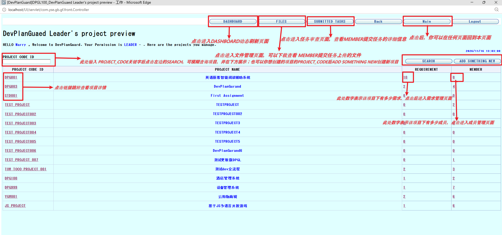
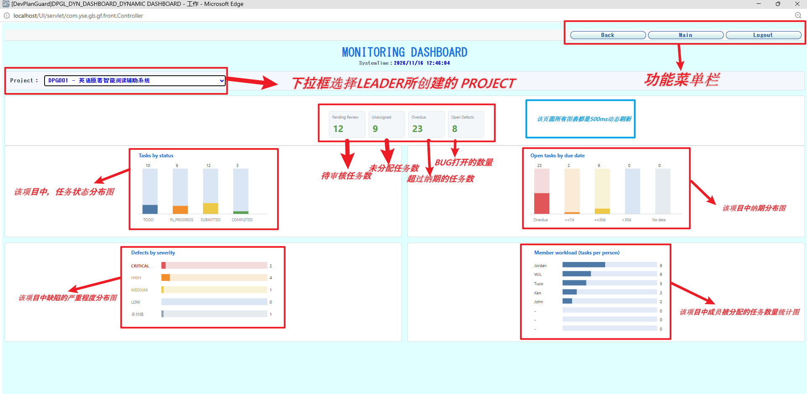
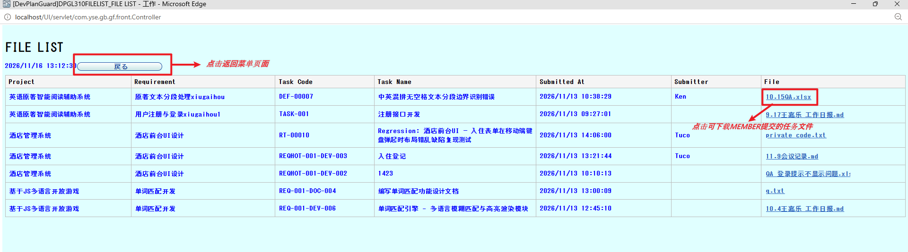
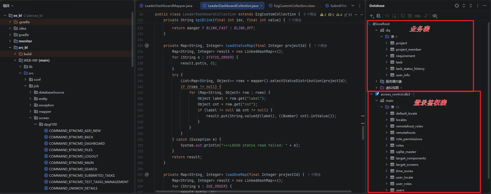

# DevPlanGuard — Keep Development on Track.

**A Project Progress and Quality Management System for Software Development Teams**

DevPlanGuard is a project management system designed for small software development teams. It provides a structured workflow for managing project requirements, development tasks, testing, bug fixes, and project progress.

The system focuses on task workflow automation, deadline tracking, and role-based access control to improve development transparency and project management efficiency.

## PROJECT_SHOW(To be completed)

## 

---

## 

---

## 

---

## 

---

## 

---

## 

---

## Key Features

### 1. Project Management

- Create and manage software development projects.
- Manage project members and their responsibilities.
- Assign project leaders and project managers.
- Track overall project progress.

### 2. Requirement Management

- Create and maintain project requirements.
- Associate requirements with development tasks.
- Track requirement implementation progress.
- Manage requirement status and changes.

### 3. Task Management

- Support multiple task types:
  - Development
  - Testing
  - Bug Fixing
  - Regression Testing
  - Documentation

- Assign tasks to team members.
- Track task status and completion.
- Maintain parent-child relationships between related tasks.

### 4. Automated Task Workflow

Automatically generate follow-up tasks based on task types and execution results, reducing repetitive manual operations.

**Workflow:**

```text
Development Task
       |
       v
   Submission
       |
       v
 Automatically Create
    Testing Task
       |
       v
   Testing Process
       |
       +------ Passed ------> Co
```

WANGJIALE おうかがく　---A COMPUTER SCIENCE LEANER
